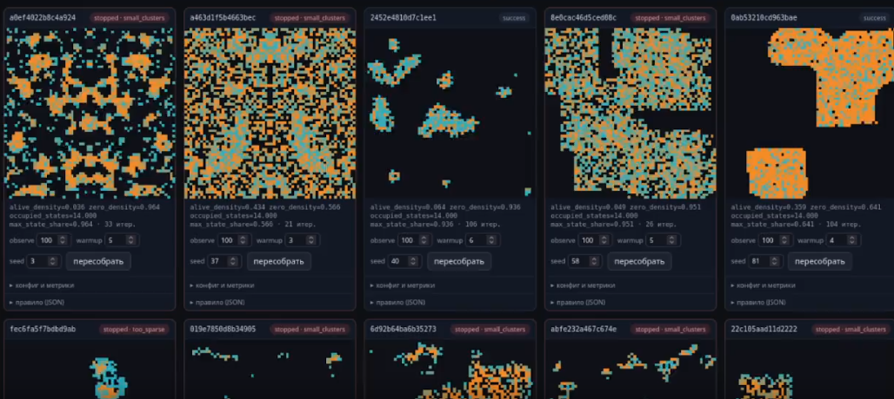
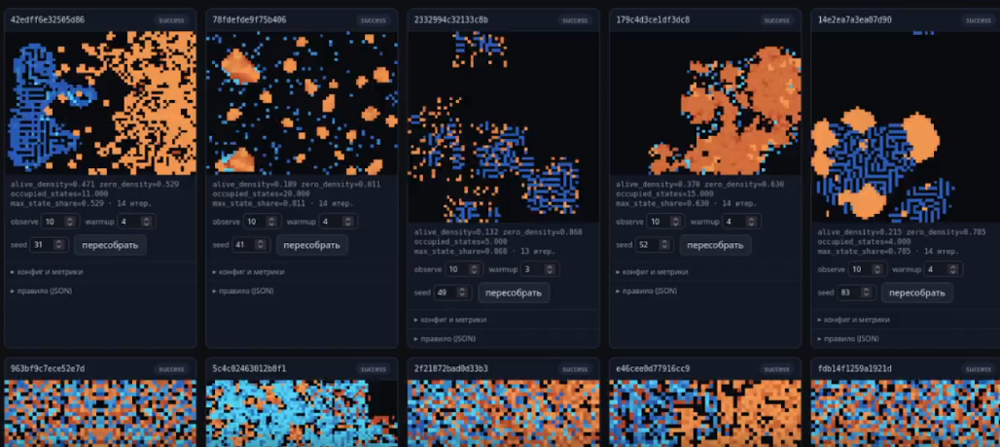

#

## Идея

### Проблема
Даже для простого автомата число условий может быть множество, например, автомат Game of Life:

1) 2 возможных состояния (клетка жива, клетки нет (мертва))
2) 3 возможных реакции (смерть, рождение, выживание)
3) число соседей от 0 до 8

Среди этого множества условий может быть множество возможных реакций, как имеющих смысл, так и нет, примеры таких:
1) если клетка жива, она умирает если число соседей больше/меньше/ровно некоторому значению. Условия могут пересекаться
2) если клетка жива, она выживает если число соседей больше/меньше/ровно (условие)
3) если клетки нет, она рождается, если число соседей больше/меньше/ровно (условие)
(В общем, некоторое число условий, не стал вычислять)

Но если мы определяем число соседей не как сумму по кольцу 3 на 3 вокруг целевой клетки, а, например, как наличие определённых клеток в некоторой маске? Таких масок, как минимум, может быть 2^8.

### Решение
Написать программу с логикой клеточного автомата, но вместо переменных использовать сущности, значение которых заранее однозначно не предопределено. Возможные значения сущностей определяются в отдельном порядке.
Возможных значений может быть огромное множество, поэтому каждый тест будет прогоняться отдельно, в отдельном потоке, а низкоуровневые функции будут компилироваться, например, чеерз numba. 

## Примеры

результаты пятой попытки. 
Перебор автоматов со стратегиями смерти/рождения/выживания по числу соседей

Перебор автоматов со стратегией двух взаимодействующих групп (оранжевая и синяя)
